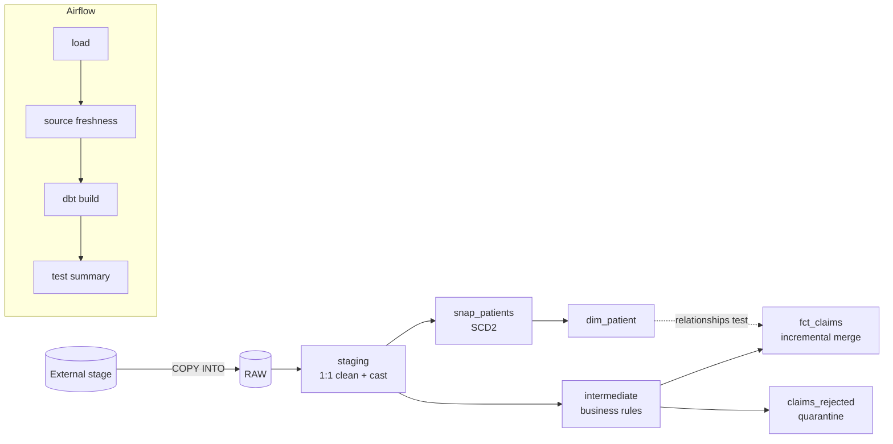

# Healthcare Claims - dbt Core on Snowflake

A small but production-shaped analytics engineering project: **dbt Core** transformations on **Snowflake**,
**code-based data testing**, **Git-driven CI/CD**, and **Airflow orchestration**. No dbt Cloud required -
everything (testing, environments, scheduling, reporting) is defined in code and versioned in Git.

> Data is synthetic. Seeds exist only for dev/CI; in prod, `RAW` is loaded by the ingestion pipeline.

## Architecture



## What this project demonstrates

| Capability | Where |
|---|---|
| Layered dbt Core project (staging / intermediate / marts) | `models/`, `dbt_project.yml` |
| Reusable logic via macros and vars | `macros/claim_category.sql`, `vars:` |
| Incremental models, merge strategy, late-arriving data | `models/marts/fct_claims.sql` |
| SCD Type 2 snapshot and dimension | `snapshots/snap_patients.sql`, `dim_patient` |
| Model contracts (schema enforced at build) | `fct_claims`, `dim_patient` |
| **Unit tests** with mocked inputs (boundary values, NULLs) | `models/intermediate/_intermediate__models.yml` |
| **Data tests**: generic, custom generic, singular, package (`dbt_utils`, `dbt_expectations`) | `*.yml`, `tests/` |
| Source freshness gates | `_healthcare__sources.yml` |
| Quarantine pattern (bad rows kept and explained, never silently dropped) | `claims_rejected` |
| Legacy-to-Snowflake reconciliation (`audit_helper`) | `analyses/migration/` |
| Environment isolation (dev / ci / prod) | `profiles.yml.example`, `generate_schema_name` |
| Slim CI (`state:modified+ --defer`), lint, per-PR schemas, cleanup | `.github/workflows/ci.yml` |
| Gated production deploy + manifest publishing | `.github/workflows/cd.yml` |
| Orchestration with freshness gate and always-run test report | `airflow/dags/` |
| Test reporting from `run_results.json` (no dbt Cloud UI needed) | `scripts/summarise_run_results.py` |

Inventory: 6 models, 1 snapshot, 3 seeds, 2 sources, **37 data tests, 2 unit tests**.

## Test strategy (summary)

See [`docs/test-strategy.md`](docs/test-strategy.md) for the full approach.

| Level | Purpose | Mechanism |
|---|---|---|
| Unit | Business logic correct in isolation | dbt unit tests (mock inputs) |
| Contract | Output schema is what consumers expect | `contract: enforced` |
| Data quality | Grain, nulls, domains, referential integrity, ranges | generic + package tests |
| Reconciliation | Nothing lost or invented between layers or vs legacy | singular test, `audit_helper` |
| Freshness | Sources are current before we transform | `dbt source freshness` |

Severity policy: structural or integrity failures **error** (block deploy). Data-content issues that need
business triage (e.g. NULL `claim_amount`) **warn**, and the rows are routed to `claims_rejected` with a reason.

## Quickstart

```bash
cd dbt_snowflake
python -m venv .venv && source .venv/bin/activate
pip install -r requirements-dev.txt
cp profiles.yml.example ~/.dbt/profiles.yml    # then set SNOWFLAKE_ACCOUNT / SNOWFLAKE_USER
dbt deps
dbt seed                                       # synthetic RAW data into your dev schema
dbt build                                      # models + snapshots + unit tests + data tests
python scripts/summarise_run_results.py        # pass-rate summary
```

Useful commands:

```bash
dbt build --select +fct_claims                 # a model and all its upstream
dbt test --select test_type:unit               # unit tests only
dbt source freshness                           # freshness gate
dbt compile -s reconcile_legacy_vs_snowflake   # then run the compiled SQL in Snowflake
sqlfluff lint models macros snapshots tests
```

## Environments

| Target | Auth | Schemas | Used by |
|---|---|---|---|
| `dev` | SSO (browser) | `dbt_<user>_<layer>` | Developers |
| `ci` | Key-pair | `ci_pr_<n>_<layer>`, dropped after each run | Pull requests |
| `prod` | Key-pair | `staging`, `intermediate`, `marts`, ... | CD workflow / Airflow only |

Promotion path: feature branch -> PR (lint + Slim CI) -> review (CODEOWNERS) -> merge -> CD deploys to prod
behind an approval-gated GitHub Environment -> prod manifest is published for the next Slim CI run.

Required GitHub secrets: `SNOWFLAKE_ACCOUNT`, `SNOWFLAKE_CI_USER`, `SNOWFLAKE_CI_PRIVATE_KEY`,
`SNOWFLAKE_PROD_USER`, `SNOWFLAKE_PROD_PRIVATE_KEY`, `SNOWFLAKE_PRIVATE_KEY_PASSPHRASE`.

## Design decisions

- **Staging is 1:1.** No filtering or business rules; those live in `intermediate`. Bad rows are *flagged*, then
  quarantined, so data loss is visible and testable.
- **One definition of banding.** `claim_category` is a macro driven by vars; thresholds are never hard-coded in SQL.
- **Contracts on marts only.** Consumers get a stable schema; internal layers stay flexible.
- **Incremental with lookback.** Re-processes 3 days of loads; `merge` on `claim_id` keeps it idempotent.
- **`dbt build`, not `dbt run`.** Tests run in DAG order, and downstream models are skipped when upstream tests fail.
- **Env vars, not Airflow Variables, at DAG parse time.** Avoids a metadata-DB query on every parse.

## Known limitations / roadmap

- Validated with `dbt parse` and a DAG import check; the full build has **not** been executed against a live
  Snowflake account from this repo yet. Contract data types may need small adjustments on first run.
- Next: masking policies on PII columns, Snowflake RBAC as code (Terraform), `dbt_project_evaluator` in CI,
  elementary or similar for test-result trending, microbatch incremental for larger volumes.
